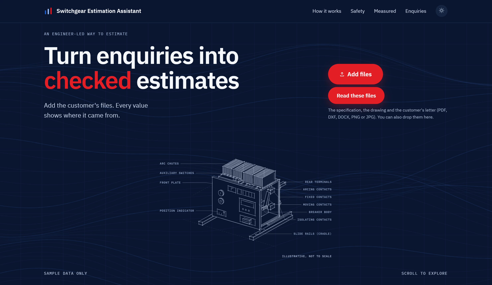
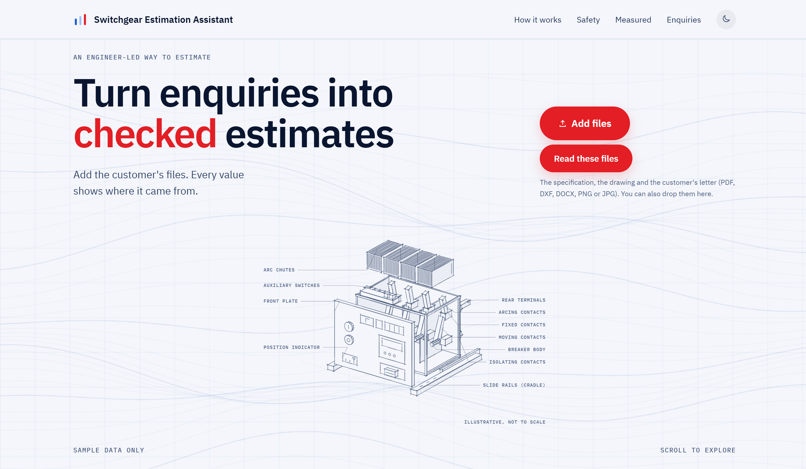
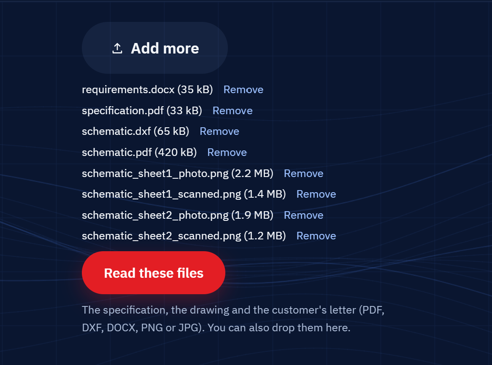
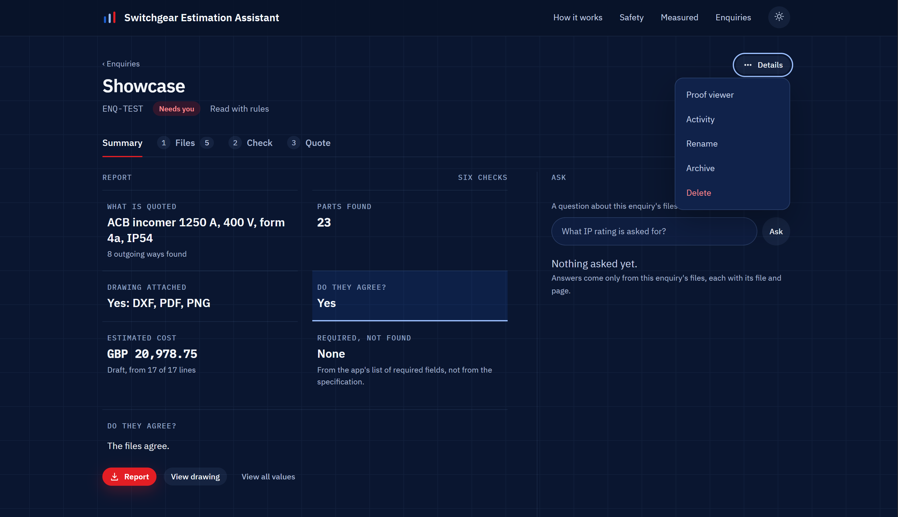
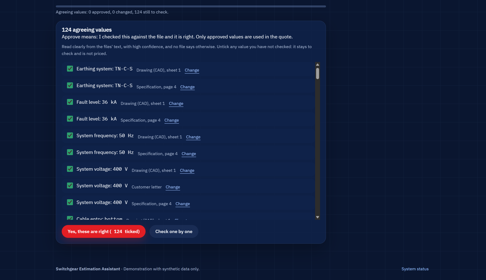
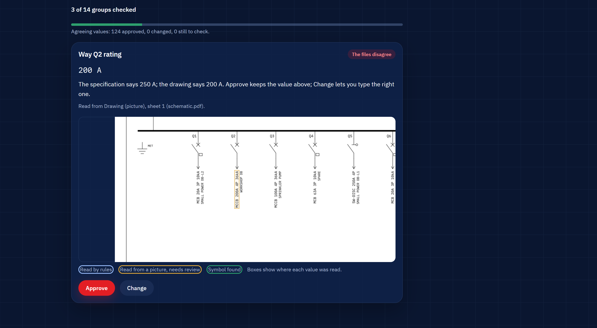
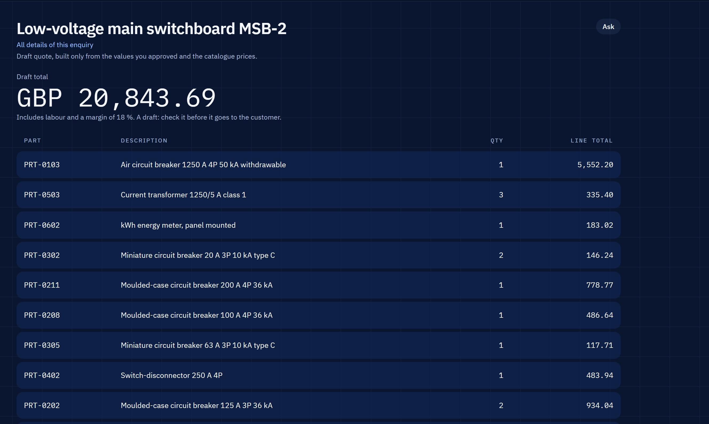
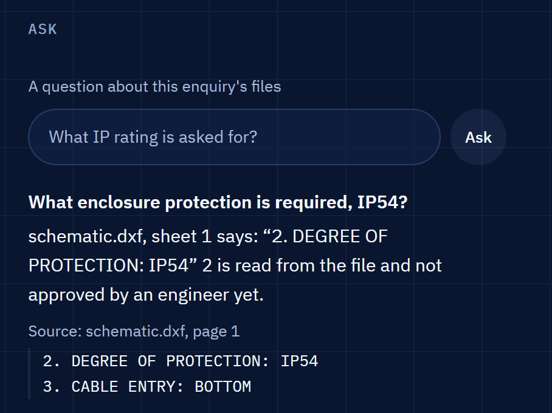

# Switchgear Estimation Assistant

A web application for an estimating engineer who receives a customer enquiry for low-voltage switchgear: a specification PDF, a single-line drawing and a letter. It reads the files, finds the ratings, devices and quantities, cross-checks the files against each other, matches parts to a catalogue and builds a draft quote. Every value shows the file, page and text it came from. **Nothing is priced until a person approves the value**: the quote is built only from approved values and catalogue prices, never from a guess.

> **Disclaimer:** this is an independent personal project. It uses synthetic data only: every document, drawing, part code and price is invented. It is not affiliated with or endorsed by any company.





## How it works

**1. Add the files.** Drop the specification, the drawing (DXF, PDF or picture) and the letter. They are listed before anything is read.



**2. Read the summary.** Six checks: what is quoted, the parts found, whether a drawing is attached, whether the files agree, the draft cost and the required fields not found. The question box sits on the right.



**3. Check the values.** Values that agree across the files come as one group: untick anything you have not checked, then approve the rest. Values where the files disagree get their own card, with both sources and a box on the drawing where the value was read.





**4. Get the quote.** Part, description, quantity and line total, from approved values and catalogue prices only. It is rebuilt after every decision and can be exported as a Word report.



**The approval rule.** A value read by rules, OCR or a model is only a suggestion. It reaches the quote when an engineer approves it (or types the right value). Values read from a picture or by a model are never approved in bulk.

## What it reads, and with what

| Part | How |
|---|---|
| Specification and letter text | Plain code: rules for ratings, poles, form, IP rating, voltage, fault level and quantities. Each value keeps its exact source text and page. |
| Language model | `gemma4:e2b` through Ollama reads each page into a fixed schema. Every value must quote its source; code checks the quote is on that page, or the value is rejected. |
| Drawing pictures | Tesseract OCR for scanned and photographed drawings. `gemma4:e2b` through Ollama also reads drawing pictures (vision). DXF drawings are read from their text directly. |
| Symbols on the drawing | Template matching (classic computer vision, not a trained network) finds the breaker symbols. |
| Question box | `mxbai-embed-large` embeddings for search (a simple word embedder on the laptop). |

**Where the model results come from.** The laptop has no GPU, so the models run on Google Colab (T4). Their outputs are saved as recordings, each tied to the SHA-256 of the exact input file, and replayed on the laptop. A recording is refused for any other file. **The website's read mode currently uses rules and OCR**; the recordings feed the evaluation scores below.

## The question box

Ask a question about the open enquiry, for example "What IP rating is asked for?". It is retrieval over the enquiry's own files, not a chatbot:

- it searches only this enquiry's specification, letter and drawing text;
- the answer quotes the passage with its file and page;
- with no passage close enough, it refuses and says there is no evidence;
- numbers in the answer are checked against approved values and marked "not approved yet" when they are not;
- every question and answer is saved and audited. It can only read; it cannot approve or change anything.



## Results

All numbers are from [docs/evaluation.md](docs/evaluation.md). F1 over every value; a value counts when its field, file, page, value and unit match the answer key.

- **Fresh set**: 20 new enquiries, frozen by hash and never tuned on. It uses the same generator as the test set, so it is held out but not real-world data.
- **Test set**: 20 enquiries used during development. **Not held out.**

| Reading | Fresh set (frozen, never tuned on) | Test set (not held out) |
|---|---|---|
| Rules, with the DXF | 0.758 | 1.000 |
| Rules, drawing not read | 0.405 | 0.654 |
| Rules + model, with the DXF | 0.850 | 0.944 |
| Rules + model, drawing not read | 0.566 | 0.643 |
| Model alone, with the DXF | 0.763 | 0.778 |
| Model alone, drawing not read | 0.534 | 0.561 |
| Rules + OCR, clean / scanned / photo drawing | 0.674 / 0.663 / 0.493 | 0.948 / 0.934 / 0.814 |
| Rules + OCR + vision, clean / scanned / photo | 0.722 / 0.725 / 0.606 | no vision recordings |
| Symbol detector, clean / scanned / photo | 0.887 / 0.892 / 0.887 | 0.896 / 0.909 / 0.872 |

| Other checks | Fresh set | Test set |
|---|---|---|
| Planted conflicts found (rules, with the DXF) | 8 of 10, 1 false flag | 10 of 10, 1 false flag |
| Question box, right passage first: words / mxbai-embed-large | 0.593 / 0.708 | not in the report |
| Question box refusals (right refusals): words / mxbai-embed-large | 15 (5) / 29 (20) | not in the report |

Half of the fresh set is reworded (new phrasing, clause order and unit styles), which the rules were not written for: that is most of the gap between the two columns, and where the model helps most. Model rows use the strict quote check.

## Safety and security

Tested ([docs/stage-8.md](docs/stage-8.md)):

- uploads: zip bombs, pixel bombs, fake file types, oversized and empty files are refused; file names cannot escape storage;
- HTML, script and SQL text in every field are stored as data and shown escaped;
- a hidden instruction in a PDF is flagged on Check, in the proof viewer and in the question box, and never obeyed;
- every approve, change and reject is audited with its actor;
- secrets scan, licence check (permissive licences only) and pip-audit are clean; containers run as non-root with memory limits.

Not built:

- no login and no roles: the app listens on 127.0.0.1 only;
- no CSRF tokens and no rate limit;
- prompt injection is caught by text patterns only: an instruction worded differently is not flagged, although no model output can approve a value or change a price.

## Known limits

- **ACB read as MCCB.** The symbol detector finds almost no air circuit breakers (0 to 3 of 20 per drawing version), because an ACB symbol contains the MCCB symbol.
- **No real drawings tested.** Every score is on synthetic enquiries; real drawings are messier.
- **10 vision sheets cut off.** 10 of 120 fresh-set drawing sheets were not read because the model's reply stopped mid-answer. The reader now keeps the complete part of such a reply; the 10 sheets wait to be recorded again.
- **mxbai refuses more.** It finds the right passage more often than the word search, but refuses 29 questions against 15; 9 of its refusals were wrong, just under its threshold.
- **Word search can show an unrelated passage.** On the laptop the question box uses a word embedder: a rating question once quoted a voltage clause because "rated" and "rating" share a stem. The file and page are always shown, so a wrong passage is visible.
- **The model adds wrong values too.** Rules + model raises recall but lowers precision (fresh set 0.971 to 0.842), so model values always need a person.

## How to run

Needs Docker Desktop (on an 8 GB laptop, cap its memory first: [steps](docs/stage-0.md#cap-docker-and-wsl-memory)). From the repo folder:

```powershell
docker compose up --build
```

Open <http://127.0.0.1:8000/>. "Try the sample enquiry" on the home page loads an invented enquiry. Never run `docker compose down -v`: it deletes the database.

Run the tests (Python 3.12 or later):

```powershell
python -m venv .venv
.venv\Scripts\Activate.ps1
pip install -r requirements-dev.txt
python -m pytest
```

Database tests run when `DATABASE_URL` points at a PostgreSQL with pgvector (for example the Docker one); they use their own test database and never touch the app's data.

**Recordings are never committed.** Model recordings live in git-ignored folders (`data/recorded*`). Without them the app and the tests run in rules mode, and the model rows of the evaluation say "waiting for Colab recordings". How they are made: [docs/recording-model-answers.md](docs/recording-model-answers.md).

## Stage docs

| Stage | Doc |
|---|---|
| 0 Setup | [stage-0.md](docs/stage-0.md) |
| 1 Synthetic data | [stage-1.md](docs/stage-1.md) |
| 2 Upload to report, rules mode | [stage-2.md](docs/stage-2.md) |
| 3 Language model extraction | [stage-3.md](docs/stage-3.md) |
| 4 Drawing reading | [stage-4.md](docs/stage-4.md) |
| 5 Cross-document checks | [stage-5.md](docs/stage-5.md) |
| 6 Confidence and review | [stage-6.md](docs/stage-6.md) |
| 7 Evaluation on a fresh set | [stage-7.md](docs/stage-7.md), [evaluation.md](docs/evaluation.md) |
| 8 Safety and security | [stage-8.md](docs/stage-8.md) |
| 9 Question box | [stage-9.md](docs/stage-9.md) |
| Screens | [stage-ux.md](docs/stage-ux.md), [stage-simple.md](docs/stage-simple.md) |

## Licences

Only permissive licences are used. AGPL libraries (for example PyMuPDF and Ultralytics YOLO) are excluded, and so are fpdf2 (LGPL), pdf2image and Poppler (GPL). Versions are those tested (Stage 0 for the web stack, Stage 1 for the data generator, Stage 2 for reading and export).

| Component | Version | Licence | Used for |
|---|---|---|---|
| FastAPI | 0.162.0 | MIT | Web framework |
| Starlette | 1.10.0 | BSD-3-Clause | ASGI toolkit under FastAPI |
| Uvicorn | 0.54.0 | BSD-3-Clause | ASGI server |
| Jinja2 | 3.1.6 | BSD-3-Clause | Templates |
| Pydantic, pydantic-settings | 2.14.1, 2.16.2 | MIT | Data models, settings |
| SQLAlchemy | 2.1.8 | MIT | Database access |
| Alembic | 1.20.1 | MIT | Migrations |
| pg8000 | 1.31.6 | BSD-3-Clause | PostgreSQL driver (chosen over psycopg, which is LGPL) |
| ollama (Python client) | 0.6.3 | MIT | Model calls in live mode |
| pytest | 9.2.0 | MIT | Tests (development only) |
| httpx2, httpcore2 | 2.16.0 | BSD-3-Clause | Test client (development only); replaces httpx for Starlette's TestClient |
| ezdxf | 1.4.5 | MIT | App: reads the text entities of uploaded DXF drawings. Generator: writes the schematic DXF and renders it through its matplotlib backend (the PyMuPDF backend is not used) |
| matplotlib | 3.11.2 | Matplotlib licence (PSF-based, BSD-style) | Vector PDF of the schematic |
| reportlab | 5.1.0 | BSD-3-Clause | Specification PDF |
| python-docx | 1.2.0 | MIT | App: reads letters, exports the DOCX report. Generator: requirements letter |
| pdfplumber, pdfminer.six | 0.11.10, 20260107 | MIT | App: PDF text and tables per page |
| htmx | 2.0.4 | Zero-Clause BSD | Partial page updates, vendored (`frontend/static/js/htmx.LICENSE.txt`) |
| python-multipart | 0.0.33 | Apache-2.0 | App: file uploads |
| pypdfium2 (PDFium) | 5.14.0 | Apache-2.0 or BSD-3-Clause (PDFium: BSD-3-Clause) | PDF to image (generator; app: drawing PDF pages for OCR), PDF text in tests |
| Pillow | 13.0.0 | MIT-CMU | Scan and photo effects; app: drawing images for OCR |
| pytesseract | 0.3.13 | Apache-2.0 | App: calls Tesseract for drawing OCR (Stage 4). Declares Python up to 3.12 only; tested working on 3.14.4 |
| Tesseract OCR (with the `eng` data) | 5.4.0 on the laptop (UB Mannheim build); Debian's `tesseract-ocr` package in Docker and CI | Apache-2.0 | App: drawing OCR, a separate program, not a Python package |
| numpy | 2.5.4 | BSD-3-Clause | Scan and photo effects, homographies; app: the symbol detector (Stage 4 Part C) |
| PostgreSQL | 16 | PostgreSQL Licence | Database (Docker image) |
| pgvector | 0.8.7 | PostgreSQL Licence | Vector search extension |
| IBM Plex Sans, IBM Plex Mono | 1.1.0 | SIL OFL 1.1 | Fonts, self-hosted (`frontend/static/fonts/OFL.txt`) |
| IBM Plex Sans Condensed, IBM Plex Serif, IBM Plex Mono (TTF) | from the Google Fonts repository | SIL OFL 1.1 | Drawing and specification text in generated documents (`data_generator/fonts/OFL-IBMPlex.txt`) |
| Caveat | variable font, Google Fonts repository | SIL OFL 1.1 | Handwritten-style note on scanned and photo drawings (`data_generator/fonts/OFL-Caveat.txt`) |
| Icons | n/a | This repo | Drawn for this project |
| Gemma 4 E2B (`gemma4:e2b`) | n/a | Apache-2.0 ([model card](https://huggingface.co/google/gemma-4-E2B-it)) | Chat and vision model, on Colab only |
| mxbai-embed-large | v1 | Apache-2.0 ([model card](https://huggingface.co/mixedbread-ai/mxbai-embed-large-v1)) | Embedding model, on Colab only |

Transitive dependencies (for example AnyIO, Click, MarkupSafe, Mako, scramp, typing-extensions, fontTools, lxml, contourpy, kiwisolver, cycler, pyparsing, python-dateutil, truststore, charset-normalizer, cryptography, cffi, pycparser) are MIT, BSD, Apache-2.0, Apache-2.0 OR BSD-3-Clause (cryptography), MIT-0 or PSF-2.0. Drawings for `data/external/` may be made in QElectroTech or LibreCAD (both GPL-2.0); those tools are not dependencies and none of their code is in the repo. Model licences are from the Hugging Face model cards (checked 5 Nov 2026).
