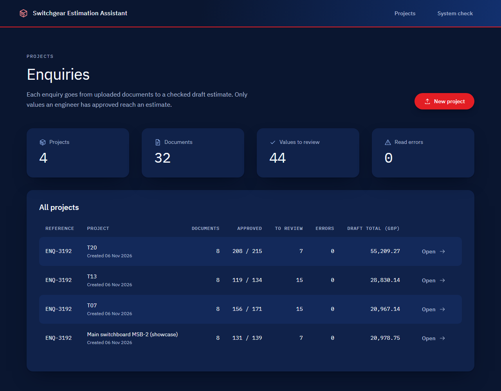
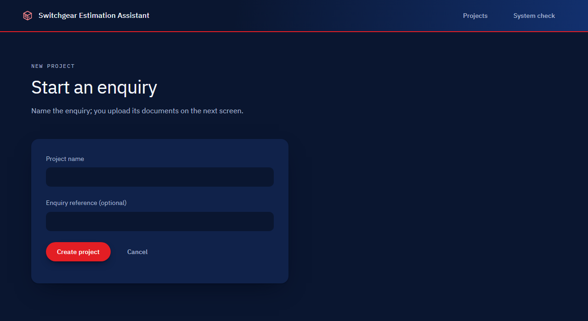
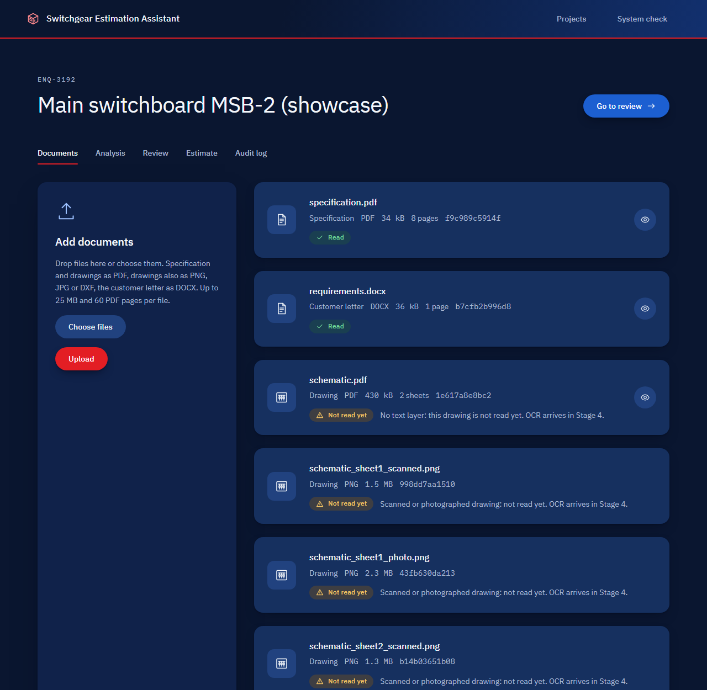
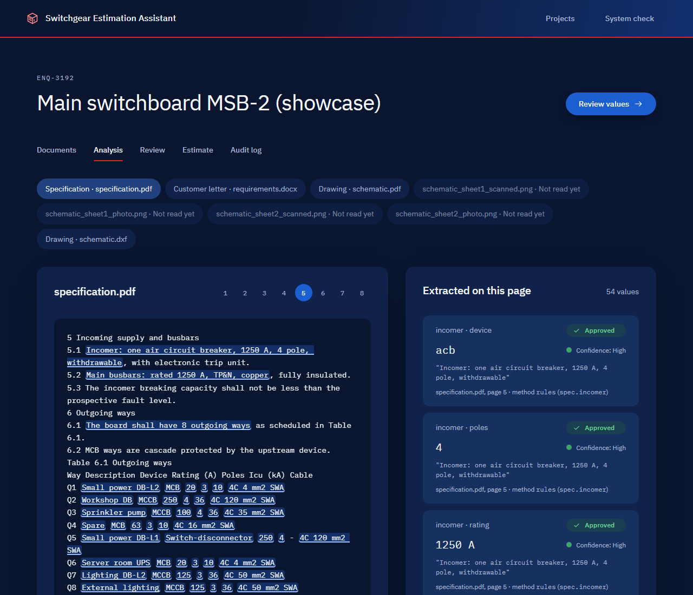
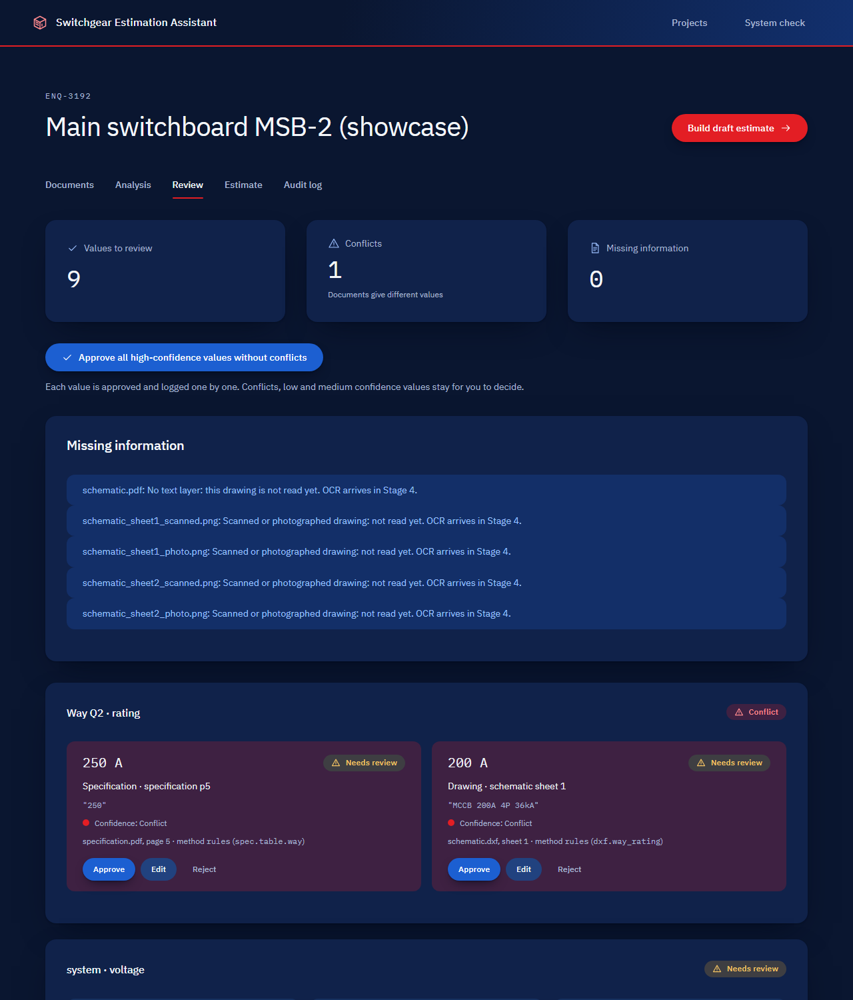
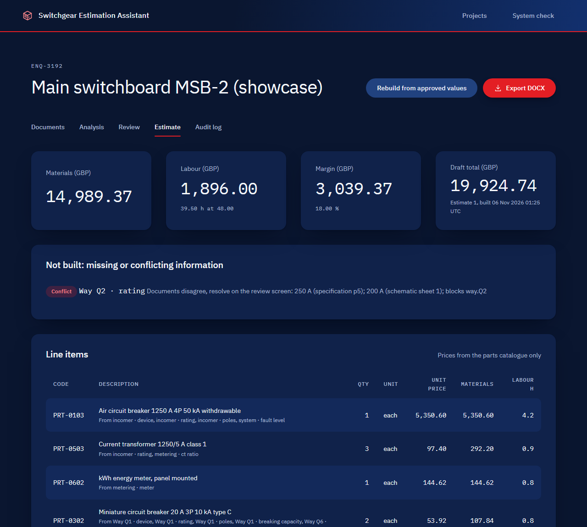
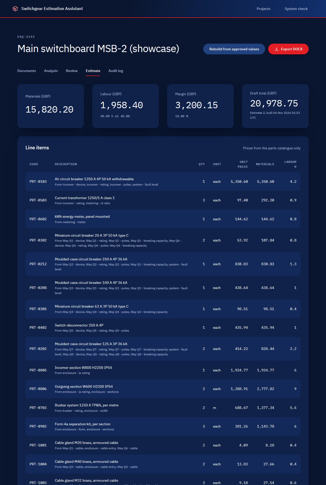
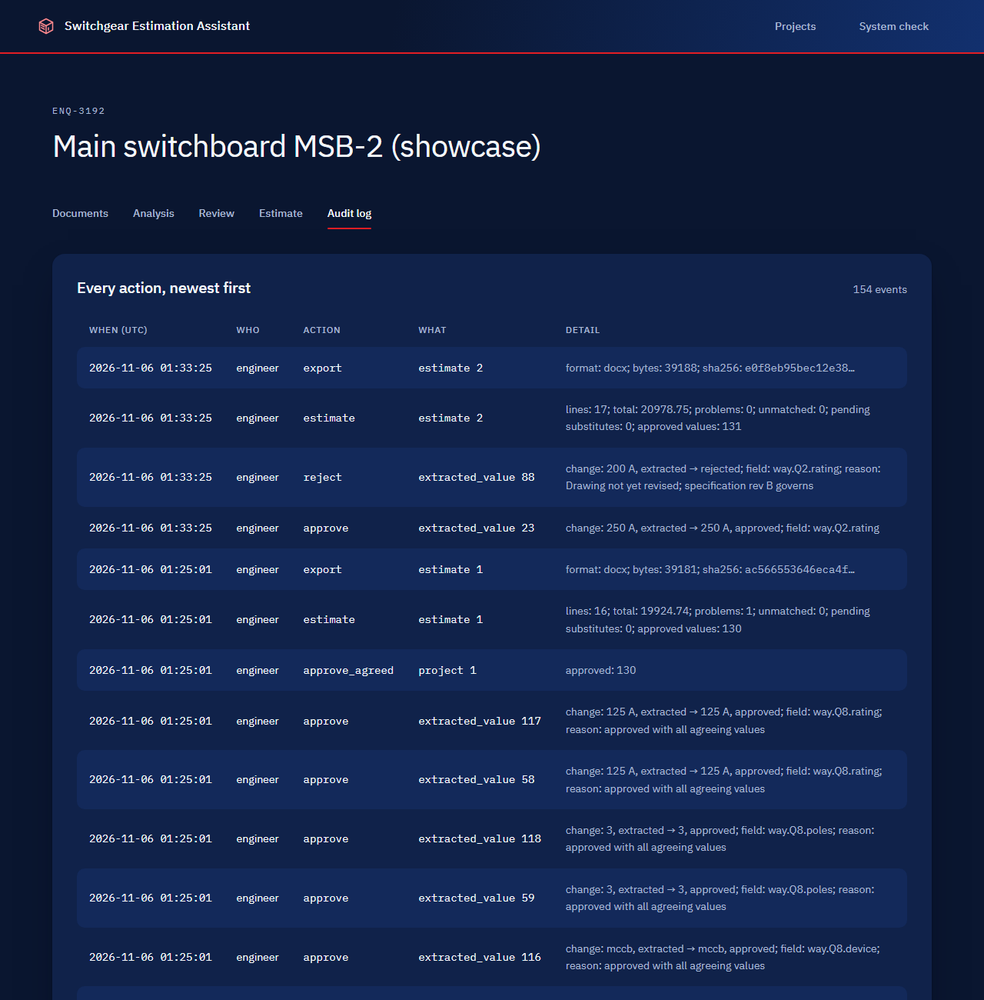

# Stage 2: thin end-to-end slice, rules mode

The showcase enquiry now goes from upload to an exported DOCX report in the app, with no model at all. Every number in the estimate comes from an approved value that links to its document, page and source text, and every price comes from the parts catalogue. This rules-mode result is the baseline every AI step in later stages must beat.

## What was built

| Piece | Where | What it does |
|---|---|---|
| Database tables | `backend/app/models.py`, `backend/migrations/versions/0002_core_tables.py` | projects, documents, pages, extracted_values, catalogue_items, matches, estimates, estimate_lines, reviews, audit_events. Alembic migrations; the app migrates on start-up. Postgres in Docker and CI, SQLite for fast local tests (portable types only) |
| Storage | `backend/app/storage.py` | A `Storage` interface with a local-folder implementation (object storage later). Originals are stored byte for byte under a generated id (`<32 hex>.pdf`), never under the user's filename, which is kept only as data. SHA-256 of the bytes as received. Accepts PDF, PNG, JPG, DXF and DOCX only: the extension and the content signature must agree. Size and PDF page limits come from config (`MAX_UPLOAD_MB` 25, `MAX_PDF_PAGES` 60) |
| Reading | `backend/app/reading.py` | pdfplumber: text and tables per page, page numbers kept. python-docx: letter text. ezdxf: text entities of an uploaded DXF, one page per drawing sheet. PDFs without a text layer and PNG/JPG drawings are marked "not read yet" (OCR is Stage 4) |
| Rule extractor | `backend/app/extraction.py`, `backend/app/normalise.py` | Ratings (A, kA, V), poles, form of separation, IP rating, quantities, part types, cables, metering, cable entry, sections and width. Every value keeps its exact source text and page, method `rules`, a fixed confidence per rule, and review status `extracted` |
| Catalogue matcher | `backend/app/catalogue.py` | Loads `data/catalogue/catalogue.csv` into `catalogue_items`. Exact match first; otherwise the next size up becomes a **substitute, needs review** with a reason (for example "250 A chosen, 225 A requested: no 225 A part with the other properties"); otherwise **unmatched**. It never guesses a price |
| Estimate rules | `backend/app/estimate.py`, `config/estimate.toml` | Quantity x catalogue price, labour hours x an invented rate (GBP 48.00 per hour), an invented 18 % margin, totals, an unmatched list, and a list of what could not be built. Only approved values are used (see below) |
| Screens | `backend/app/web.py`, `frontend/templates/` | Dashboard, new project, documents and upload (drag and drop, file cards, live progress), analysis, review, estimate, audit log, DOCX export |
| Report | `backend/app/report.py` | DOCX with totals, lines, the sources of each line (document, page, quoted text), approved substitutes and everything not priced |
| Audit log | `services.audit` | One event for every upload, rejected upload, extraction, approval, edit, rejection, bulk approval, estimate, substitute decision and export (with the report's SHA-256) |
| Background work | FastAPI background tasks | Each upload is read after the response; the file cards poll every second until every file is read |
| Evaluation | `backend/evaluate.py`, `backend/app/evaluation.py`, `backend/check_estimates.py` | Precision, recall and F1 per field on the 20 test projects; an end-to-end estimate check through the web app |

### How a value reaches the estimate

1. A document is read and the rules extract values, each with value, unit, document, page, source text, rule, method and confidence.
2. The engineer reviews them on the review screen: **approve**, **edit** (approve with a typed value and an optional reason) or **reject** (a reason is required). Each action is one review row and one audit event. An edit keeps the extracted value and its source untouched; the approved value is stored next to it.
3. **Approve all high-confidence values without conflicts** approves, one by one and each audited, only values that are high confidence and in a field where no documents disagree. It leaves for the engineer:
   - conflicts;
   - medium and low confidence values (the customer letter is medium);
   - a field that one document leaves open (for example "TBC") while another gives a value;
   - a way that is missing from one of the documents that list the ways.
4. The estimate reads **approved and edited values only**. For each field it needs:
   - one distinct approved value is used;
   - none means the field is missing;
   - more than one means a conflict, and the lines that need the field are not built.

   Unreviewed values are never priced. They are used only to tell "the documents disagree" from "nothing approved yet", so an open conflict is reported as a conflict.
5. A stated section count and board width follow the ways. While the number of ways is in conflict, or a way rating is in conflict between values that would need a different number of section units (above 400 A a way takes two), the stated sections and width are held back, and with them the outgoing sections, busbar and form kits. The incomer section is always one section and is still priced.
6. A substitute part is priced only after the engineer approves it on the estimate screen. If the requirement behind it changes, it needs approval again.

## Screens

All screenshots are of the Docker stack at 1280 px wide (headless Edge), showcase project.

**Projects dashboard**: counts, values to review, read errors, draft totals.


**New project**


**Documents and upload**: drag and drop or choose files; each file card shows type, size, page count, the start of its SHA-256 and its status. The drawing PDF and the PNGs are marked "Not read yet" with the reason.


**Analysis**: document text on the left with the source of every value highlighted; values on the right with source, rule, method and confidence. Page 5 of the specification.


**Review**: conflicts first, both sources side by side (here way Q2: 250 A in the specification, 200 A on the drawing), then the drawings that are not read yet, then every field.


**Estimate with the conflict still open**: everything else is priced; the Q2 breaker is listed as not built.


**Estimate after review**: the engineer rejected the drawing's 200 A with a reason and approved the specification's 250 A. All 17 lines equal the answer key's lines.


**Audit log**


## How to run it

With Docker, from the repo folder in PowerShell:

```powershell
docker compose up --build
```

Open <http://127.0.0.1:8000/>, choose **New project**, then drop these files from `data\projects\showcase\` on the upload card: `specification.pdf`, `requirements.docx` and `drawing\schematic.dxf`. Add `drawing\schematic.pdf` and the PNGs too if you like; they are marked "not read yet". Then:

1. Go to **Review** and press **Approve all high-confidence values without conflicts**.
2. In the **Way Q2 · rating** conflict, reject the drawing value (give a reason) and approve the specification value.
3. Press **Build draft estimate**, then **Export DOCX**.

The system check page is at <http://127.0.0.1:8000/system>. Uploaded originals live in the `app-storage` volume.

Without Docker, with a local SQLite database:

```powershell
$env:PYTHONPATH = "ai_engine;."
$env:DATABASE_URL = "sqlite:///./storage/dev.sqlite"
uvicorn backend.app.main:app --reload
```

Accuracy and the estimate check (the test set is git-ignored, so build it first):

```powershell
.venv\Scripts\python.exe -m data_generator build --set test
.venv\Scripts\python.exe -m backend.evaluate
.venv\Scripts\python.exe -m backend.check_estimates
```

## How it was tested

`python -m pytest` collects 324 tests. Final runs on the laptop (Python 3.14), 6 Nov 2026:

- with `DATABASE_URL` pointing at the Docker Postgres: **324 passed** in 5 min 29 s;
- without a database: **320 passed, 4 skipped** (the four Postgres tests) in 5 min 16 s.

The Postgres tests (`test_database.py`, the Postgres migration check and the Postgres web flow) also passed against the Docker database. New in this stage:

| Suite | Tests | What it checks |
|---|---|---|
| `tests/unit/test_storage.py` | 23 | Accepted and rejected types; extension and signature must agree; size and page limits; generated keys; `..\..\x.pdf` and other names cannot leave the storage folder; hash of the bytes as received |
| `tests/unit/test_extraction_rules.py` | 41 | One or more tests per rule: specification clauses, characteristics and ways tables (TBC gives no value, low confidence), letter sentences, DXF supply, ACB, CT, meter, busbar, notes, rotated way ratings, cable schedule, ways count |
| `tests/unit/test_matcher.py` | 19 | Exact matches, breaking capacity as a minimum, substitutes with their reason, unmatched, no invented price |
| `tests/unit/test_estimate.py` | 21 | The showcase estimate from the approved answer key equals the key's lines; prices x quantities plus labour and margin; **nothing approved means no line and no price**; a conflict blocks only its lines; a value without its unit is not assumed; substitutes priced only after approval; the layout rules above; glands wait for the cable entry; a disputed MCCB breaking capacity blocks its way |
| `tests/unit/test_highlight.py` | 4 | Source highlighting in the analysis text |
| `tests/unit/test_review_rules.py` | 7 | Which values bulk approval may approve; audit details in plain words |
| `tests/integration/test_web_flow.py` | 13 | **Showcase upload to DOCX** through the web screens (statuses, hash, conflict, resolution, lines equal the key, DOCX content and sources, audit events), also on Postgres; an unapproved value cannot reach the estimate; a substitute is priced only after approval and needs approval again when its requirement changes; HTMX review actions; edits keep the source; path names cannot escape storage; rejected uploads are explained and audited; **document text with `<script>`, `` and `<b>` tags is shown escaped on the analysis and review screens**; the new-project form and its validation; screens explain a missing database |
| `tests/integration/test_migrations.py` | 2 | The migrations produce exactly the models' schema (SQLite; Postgres when available) |
| `tests/accuracy/test_rules_accuracy.py` | 2 | Rules accuracy on two test projects built on the fly (T01, T08). This is the small subset CI runs |

CI now has a `pgvector/pgvector:pg16` service and sets `DATABASE_URL`, so the database tests and the Postgres web flow run on GitHub.

## Rules-mode baseline

### When a value counts as correct

An extracted value is a true positive when an answer-key entry has:
- the same field (`way.Q3.rating`);
- the same source document (specification, schematic or requirements);
- the same page (for a drawing, the sheet);
- the same value and unit after normalising: numbers as numbers, text case-insensitive with spaces collapsed, device and meter words mapped to codes, unit spellings unified.

A "TBC" in a document is an answer-key value of `None`. Extracting `None` there is correct; any number there is wrong.

**Duplicates.** Matching is one to one: an extracted value matches at most one answer-key entry, and an entry is matched by at most one extracted value. A second extraction of the same statement is a false positive.

**Values on several pages.** The answer key records each statement on its page, so a value that appears on several pages counts once per page where the key lists it. Finding it on a page the key does not list is a false positive; missing it on a listed page is a false negative.

Fields are grouped with the way number replaced by `*`, and the "all fields" row is micro-averaged. The rules are in `backend/app/evaluation.py`.

### Results on the 20 test projects

Run on the laptop on 6 Nov 2026 with `python -m backend.evaluate`, after the test set was rebuilt for the Stage 1 fix below. Each project's upload set is the specification, the letter, the drawing PDF and the four PNG versions, with and without the DXF.

| Upload set | TP | FP | FN | Precision | Recall | F1 | Time per project |
|---|---|---|---|---|---|---|---|
| With the DXF | 3105 | 0 | 0 | 1.000 | 1.000 | 1.000 | 2.98 s |
| Without the DXF | 1508 | 0 | 1597 | 1.000 | 0.486 | 0.654 | 2.28 s |

Per field, with the DXF, every field group scores 1.000. Without the DXF no drawing value is read: the drawing PDF has no text layer and the PNGs need OCR. Recall drops to the share of values the specification and the letter state:
- about 0.5 for fields stated in the specification and on the drawing (way ratings, devices, poles, cables, busbar, earthing);
- about 0.67 for fields also stated in the letter (voltage, incomer rating, IP rating, form, cable entry, meter, ways count);
- 0 for fields only the drawing gives (`enclosure.sections`, `enclosure.width`, `way.*.cable_length`).

The full per-field tables are printed by the command above.

**Read this baseline with care.** The rules were written after reading the generator's templates, so 1.000 measures how well they cover the generator's wording, not how they generalise. A different consultant's specification would score lower. The later stages are compared on the same projects, and the real drawings of `docs/real-drawings.md` will show the gap.

### End-to-end estimates on the 20 test projects

Run with `python -m backend.check_estimates` on 6 Nov 2026. It uploads every project into a fresh app (SQLite) and presses only "Approve all high-confidence values without conflicts". Then it builds the estimate, exports the DOCX and compares the priced lines with the answer key's lines that are not blocked by a planted problem.

- **13 of 20** projects price exactly the key's lines (all the projects with no problem, the missing values, the ambiguous unit, the TBC, the prompt-injection line, and the incomer, busbar and poles conflicts).
- **0 unsafe lines.** No priced line depends on a field of a planted problem, or on a section count or width that the problem could change.
- In the other 7, the app prices lines the key blocks. T02, T07, T13 and T18 (extra or missing way) show 10, 16, 6 and 9 extra lines; T01, T09 and T17 show 1 each. These are lines of ways the problem does not touch. The key blocks a whole catalogue code when any one way using it is affected, and makes every way line depend on `ways.count`. The app blocks per way, so the unaffected ways of a shared code, and their glands, stay priced.
- Every planted problem that touches the estimate is listed on it as not built, with its reason: 39 missing or conflict entries over the 20 projects. The prompt-injection line in T08 changes no value, so T08 lists none; the line is not obeyed because rules mode never executes document text (flagging it is Stage 8).

Building these checks found and fixed three gaps in the rules before this report:
1. A disputed MCCB breaking capacity was ignored, and the breaker was sized from the fault level alone (T17).
2. Bulk approval approved the drawing's rating where the specification says "TBC" (T12).
3. An unresolved rating conflict let the drawing's section count through (T01).

Each has a test.

## Memory and time

Docker stack on the laptop (`docker stats`, 6 Nov 2026), with the limits from `deployment/docker-compose.yml`:

| State | App | Postgres | Total |
|---|---|---|---|
| Idle after start | 71.4 MiB | 32.0 MiB | 103 MiB |
| Showcase uploaded (8 files), read, estimated, exported | 115.7 MiB | 35.9 MiB | 152 MiB |
| After four projects (showcase, T07, T13, T20) | 160.9 MiB | 38.6 MiB | 200 MiB |

The limits are 384 MiB for the app and 256 MiB for Postgres, so the stack stays well inside the 8 GB budget of Stage 0 with a browser open. Each file is read in its own background task after the upload response. A drawing PNG is never decoded, because it is not read yet, and each original is dropped from memory once read.

Time per project:
- Rules reading and extraction, in-process on the laptop: 2.98 s with the DXF and 2.28 s without (mean over the 20 test projects).
- From upload to exported DOCX through the app (`check_estimates`, SQLite): mean 4.9 s, range 3.5 to 6.7 s.
- On the Docker stack over HTTP, the showcase took 5.8 s from creating the project to the exported DOCX, of which 4.1 s was reading the 8 files. Three more projects took 6.3 to 6.8 s each.

## Stage 1 fixes

**T01 answer-key gap.** In T01 the planted conflict is way Q2: 630 A in the specification, 400 A on the drawing. On the drawing, Q2's lower rating also changes the layout: the section count (4 instead of 5) and the board width are derived from it. The answer key blocked only the lines that list `way.Q2.rating` in their basis. It left the outgoing sections, busbar and form kit lines unblocked, although on the drawing they follow the conflicting rating.

The fix is in `data_generator/estimate.py` and `data_generator/project.py`:
- `affected_fields()` gives a problem's field plus every derived field (`enclosure.sections`, `enclosure.width`) whose value in an altered document differs from the true design;
- a line is blocked when its basis touches any of those.

Tests in `tests/integration/test_generator.py`:
- `test_lines_that_depend_on_a_derived_value_a_problem_changed_are_blocked` (general);
- `test_t01_section_busbar_and_form_lines_are_blocked_by_its_rating_conflict`.

Both failed before the fix and pass after it.

The test set was rebuilt (`python -m data_generator build --set test`, 124.1 s, 151.8 MB). Only T01's answer key changed: three more lines are blocked (PRT-0706 busbar, PRT-0802 outgoing sections, PRT-0902 form kits), now four in all. No other project has a line blocked through a derived field. The showcase and every committed file are unchanged, and the extraction scores above are the same as before the rebuild. The app's estimate rules apply the same idea (the layout rule above), so the app also holds these lines back in T01.

## Libraries and licences added

| Component | Version | Licence | Used for |
|---|---|---|---|
| pdfplumber (with pdfminer.six) | 0.11.10 (20260107) | MIT | PDF text and tables per page |
| python-docx | 1.2.0 | MIT | Reading letters (app); DOCX report |
| ezdxf | 1.4.5 | MIT | Reading DXF text entities (app). Now in `requirements.txt` as well as `requirements-data.txt` |
| python-multipart | 0.0.33 | Apache-2.0 | File uploads |
| htmx | 2.0.4 | Zero-Clause BSD | Partial page updates, vendored as `frontend/static/js/htmx.min.js` with its licence file |

Transitive: charset-normalizer (MIT), cryptography (Apache-2.0 OR BSD-3-Clause), cffi (MIT-0), pycparser (BSD-3-Clause). All support Python 3.12 and 3.14. They were installed and tested on 3.14 on the laptop, and imported and run in the 3.12.16 Docker image. No PyMuPDF, no OCR library and no model are used in this stage.

## Known limits

- **Rules cover the generator's wording.** See the baseline caveat above. Real documents will need more rules, or the LLM extraction of Stage 3.
- **Drawings are read from the DXF only.** The clean drawing PDF has no text layer (matplotlib draws text as outlines), and scanned and photographed drawings need OCR. All three are marked "not read yet" (Stage 4).
- **Highlights are found by text.** The analysis screen finds each value's source text in the page text, inside its way's row for table cells. A value whose source text cannot be found is listed but not highlighted. There are no drawing regions yet.
- **Quantity conflicts are handled per way.** A way listed in only one document is never bulk-approved and its lines wait. The way-count conflict itself is listed, but the other ways stay priced (see the estimate check above). The full cross-document checks are Stage 5.
- **Confidence is fixed per rule** (high, medium or low), not computed from method agreement (Stage 6).
- **No login yet.** Every action is recorded as `engineer` (Stage 8).
- **PDF export of the report is not built.** Only DOCX is.
- **An unexpected server error shows a plain-text page.** Expected errors (404, 422, 503) use the designed error page.
- **Background tasks run in the web process.** A restart during reading leaves that file as "Reading"; uploading it again is the workaround.
- **Parked design fixes** (header "Environment: development", the table heading double gap) stay for the final polish, as agreed.
